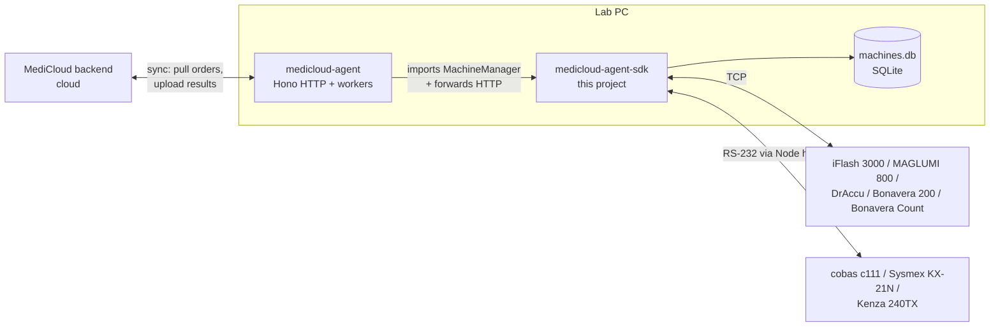
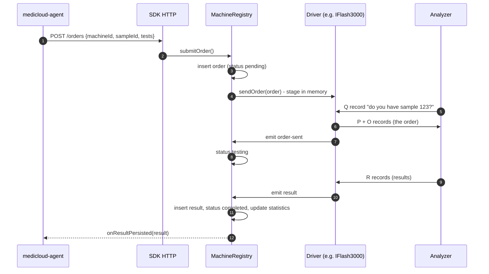

# 1. Overview and System Context

[← Index](README.md)

## What is a laboratory analyzer?

An analyzer is a machine in a medical lab that measures things in a patient sample (blood,
serum, or urine). Some examples:

- A **hematology analyzer** counts blood cells (a CBC: WBC, RBC, HGB, PLT, and so on). In this SDK:
  Sysmex KX-21N and Bonavera Count.
- A **chemistry analyzer** measures substances like glucose, urea, and cholesterol. In this SDK:
  Roche cobas c111, BioLabo Kenza 240TX, and Bonavera 200.
- An **immunoassay analyzer** measures hormones, tumor markers, and similar. In this SDK:
  YHLO iFlash 3000, SNIBE MAGLUMI 800, and DrAccu AFI-6100B.

Each analyzer has a communication port: an RS-232 serial cable or an Ethernet (TCP) socket. A
program on a PC, called the **LIS** (Laboratory Information System) or the **host**, can use this
port to:

1. **Send orders**: "sample 12345 belongs to patient X and needs TSH and FT4."
2. **Receive results**: "sample 12345: TSH = 2.1 uIU/mL, normal."

## Why an SDK?

Every vendor speaks a slightly different language. Many use the ASTM standard, but each bends it
in its own way. Others use HL7 or a vendor-specific fixed-width text format. Without a common
layer, each analyzer would need its own app.

This SDK hides those differences behind **one model**:

- Every analyzer is a **driver** class that extends [BaseMachine](../../abstracts/baseMachine.ts).
- Every driver emits the same events: `connected`, `disconnected`, `order-query`, `order-sent`,
  `result`, and `error`.
- Every result is turned into the same shape (`MachineResultEvent` in [types.ts](../../types.ts)).
- One [MachineRegistry](../../registry.ts) owns all drivers, the database, and order and result
  bookkeeping.
- One HTTP API ([http/routes.ts](../../http/routes.ts)) lets other programs manage everything.

## Where this fits

- **medicloud** (the backend) and **medicloud-app** (the UI) are outside this guide.
- **medicloud-agent** runs on the lab PC. It creates a `MachineManager`, forwards unknown HTTP
  routes to the SDK handler, pulls orders from MediCloud, posts them to the SDK
  (`POST /orders`), and uploads results that the SDK reports through `onResultPersisted`.
  Details are on [page 10](10-public-api-and-agent.md).
- **medicloud-agent-sdk** (this project) does everything that touches an analyzer.

## The two big flows in one picture

## Supported analyzers

| Driver id | Analyzer | Link | Protocol | Orders |
|---|---|---|---|---|
| `iflash3000` | YHLO iFlash 3000 | TCP server | ASTM E1394 | Host query |
| `snibe-maglumi-800` | SNIBE MAGLUMI 800 | TCP server | ASTM (numbered or staged) | Host query, plus "query all" |
| `roche-cobas-c111` | Roche cobas c111 | Serial | ASTM E1381/E1394 (Roche) | Query reply and/or push, plus result polling |
| `sysmex-kx21n` | Sysmex KX-21 / KX-21N | Serial | Sysmex fixed-width (Class A/B) | None (upload only) |
| `biolabo-kenza` | BioLabo Kenza 240TX | Serial or TCP bridge | "Custom String" Id8/Id9 | Push |
| `draccu-afi-6100b` | DrAccu AFI-6100B | TCP server | HL7 ORM over MLLP plus R-lines | Optional push |
| `bonavera-200` | Bonavera 200 | TCP server | HL7 2.3.1 over MLLP | Host query (QRY/DSR) |
| `bonavera-count` | Biogeny Bonavera Count | TCP server | HL7 2.3.1 over MLLP | Push (ORM) and query (RSP) |

Each one is described in detail on [page 6](06-machines.md).
