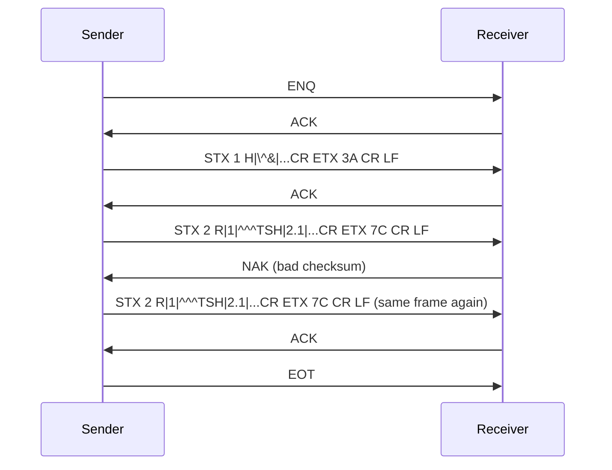

# 2. Concepts and Glossary for Lab Interfacing

[← Index](README.md)

This page explains the ideas you need before you read the protocol code. No prior knowledge is
assumed.

## 2.1 Host, LIS, and instrument

- **Instrument / analyzer**: the machine that measures samples.
- **Host / LIS**: the computer program that manages patients and orders. Here, the SDK plays the
  host role.
- **Sample ID / specimen ID / barcode**: the label on the tube. It is the **only** thing that ties
  a result to an order. If it is matched wrongly, a patient gets someone else's result. That is
  why sample matching bugs are rated Critical in [KNOWN_ISSUES.md](KNOWN_ISSUES.md).

## 2.2 Unidirectional and bidirectional

- **Unidirectional**: the analyzer only sends results. The operator types the sample and tests on
  the analyzer. Example: Sysmex KX-21N. The SDK only "stages" the order locally so it can
  recognize the result later.
- **Bidirectional**: the analyzer can also *receive* orders. There are two ways:
  - **Host query**: the analyzer scans a barcode, then asks the host "what tests for sample X?"
    The host answers. Examples: iFlash, Maglumi, cobas (optional), Bonavera 200, and Bonavera Count.
  - **Download / push**: the host sends orders on its own, with no question first. Examples: Kenza,
    cobas (`pushOrders`), DrAccu, and Bonavera Count (`pushOrders`).

## 2.3 Control characters

Serial and ASTM-style protocols use special single bytes to manage the conversation:

| Name | Hex | Meaning (simple words) |
|---|---|---|
| `STX` | 0x02 | Start of a text frame |
| `ETX` | 0x03 | End of text (last frame of a record or message) |
| `EOT` | 0x04 | End of transmission. "I'm done talking." |
| `ENQ` | 0x05 | Enquiry. "May I talk?" |
| `ACK` | 0x06 | "OK, received / go ahead." |
| `NAK` | 0x15 | "No: busy, or the frame was bad. Try again." |
| `ETB` | 0x17 | End of a block. "This record continues in the next frame." |
| `CR` / `LF` | 0x0D / 0x0A | Line endings. In ASTM, `CR` ends every record. |
| `VT` | 0x0B | MLLP start block (HL7) |
| `FS` | 0x1C | MLLP end block (HL7) |
| `XON` / `XOFF` | 0x11 / 0x13 | Serial software flow control ("resume" / "pause") |

These names are defined in [protocols/astm/constants.ts](../../protocols/astm/constants.ts),
[protocols/serial/constants.ts](../../protocols/serial/constants.ts), and
[protocols/hl7/constants.ts](../../protocols/hl7/constants.ts).

## 2.4 ASTM E1381 (the low level, also called LIS01-A2)

E1381 describes **how bytes travel**. It works like a polite phone call:

1. The sender says `ENQ` ("may I talk?").
2. The receiver says `ACK` ("go ahead"), or `NAK` ("busy").
3. The sender sends frames: `STX` + frame number (`1`..`7`, then `0`, `1`, …) + text +
   `ETX` or `ETB` + 2-character checksum + `CR LF`.
4. The receiver answers each frame with `ACK` (good) or `NAK` (bad checksum: please resend).
5. The sender says `EOT` ("I'm done"). Now either side may start a new call.

**Frame number**: a digit 0-7 that counts up and wraps after 7. It lets the receiver spot a
repeated frame (when our ACK was lost and the sender tries again).

**Checksum**: add up every byte from the frame number up to and including `ETX`/`ETB`, keep
only the lowest 8 bits (modulo 256), and write the result as 2 hex characters. The `STX` byte is
not counted. Example from [checksum.ts](../../protocols/astm/checksum.ts): `<STX>123abc<ETX>`
gives `BF`.

**Contention**: both sides send `ENQ` at the same moment. The standard says the instrument wins
and the host waits. (The SDK does not fully do this; see KNOWN_ISSUES M4.)

**Timeouts**: the standard uses 15 s to wait for a reply. The SDK uses 15 s too
(`ACK_TIMEOUT_MS`).

## 2.5 ASTM E1394 (the high level, also called LIS2-A2)

E1394 describes **what the text means**. A message is a list of **records**, one per line
(ending with `CR`). The first character is the record type:

| Type | Name | Holds |
|---|---|---|
| `H` | Header | Who is sending. It also declares the delimiters: `H|\^&` |
| `P` | Patient | Patient ID, name, date of birth, sex |
| `O` | Order | Sample ID, the tests requested |
| `R` | Result | One analyte: test ID, value, unit, range, flag, status |
| `Q` | Query | "Send me orders for sample X" |
| `C` | Comment | Free text |
| `M` | Manufacturer | Vendor-specific data |
| `L` | Terminator | End of the message |

**Delimiters** (declared in the H record, fixed in this SDK):

- `|` separates **fields**
- `\` separates **repeats** (for example, several tests)
- `^` separates **components** (parts of a field)
- `&` is the **escape** character (`&F&` means a literal `|`, and so on)

**Field numbering**: field 1 is the record type itself. So in `R|1|^^^TSH|2.1|uIU/mL`, field 3 is
`^^^TSH` and field 4 is `2.1`. The helper `astmField(record, n)` in
[records.ts](../../protocols/astm/records.ts) uses this 1-based numbering.

Standard R record fields: 3 test ID, 4 value, 5 unit, 6 reference range, 7 abnormal flag, 9 result
status (`F` final, `I` intermediate), 13 date completed.

## 2.6 HL7 v2 and MLLP

**HL7 v2** is another text format, used more in hospitals. A message is a list of **segments**
separated by `CR`: `MSH` (header), `PID` (patient), `OBR` (order), `OBX` (one result), `QRD` and
`QRF` (query), `MSA` (acknowledgement), `DSP` (display data), and others. Delimiters: `|` fields,
`^` components, `~` repeats, `\` escape, `&` sub-components.

Message types used here: `ORU^R01` (results), `ORM^O01` (order), `QRY^Q02` and `QBP` (queries),
`QCK^Q02`, `DSR^Q03`, and `RSP^K11` (query replies), and `ACK`.

**MLLP** (Minimal Lower Layer Protocol) wraps one HL7 message for TCP:
`<VT 0x0B>` + message + `<FS 0x1C><CR 0x0D>`. There are no checksums or frame numbers. The
receiver normally answers with an HL7 `ACK` message.

## 2.7 Fixed-width formats

Some analyzers do not use records with delimiters. They send fixed-width text, where each field
has an exact width and position:

- **Kenza "Custom String"**: `PatientID(9) Name(30) Species(32)` then repeated
  `Test(3) Result(9)`. The checksum is a 2-character *lower-case* hex sum (BCC) placed before `ETX`.
- **Sysmex KX-21N**: a 129-character payload: text code `D`, block number, sample code,
  date, sample ID (15), then 5-character numeric fields with implied decimals.

## 2.8 Glossary

| Term | Meaning |
|---|---|
| **Analyte** | One measured value (for example, HGB). One test can produce many analytes (a CBC has about 19). |
| **Assay / test** | What is ordered (for example, "TSH" or "CBC"). |
| **assayNo** | The analyte code the driver writes into each result (`MachineAnalyteResult.assayNo`). It is matched against the catalog analyte `code`. |
| **BCC** | Block check character. The Kenza checksum. |
| **Catalog** | Per-driver list of orderable tests and their analytes, stored in SQLite (`machine_catalogs`, `machine_catalog_tests`). |
| **Channel number** | iFlash's numeric test ID on the wire (for example, TSH = 69). |
| **Class A / Class B** | Sysmex link modes. A: one-way, no ACKs. B: the host ACKs `ENQ` and every frame. |
| **Driver** | A class in `machines/<name>/` that extends `BaseMachine`. |
| **Driver id** | Stable string such as `iflash3000` (see [lib/constants.ts](../../lib/constants.ts)). |
| **Frame** | One `STX … ETX/ETB [checksum] [CR LF]` block. |
| **Host code / app code** | Roche test numbers (for example, `767` = GLU2). |
| **Learned estimate** | Average turnaround per test, learned from completed orders (`machine_test_statistics`). |
| **Machine id / profile id** | Numeric SQLite `machine_profiles.id`. One physical analyzer has one profile. |
| **Profile** | A saved configuration (driver id + JSON config + enabled flag). |
| **Query all** | Maglumi asks for every pending order at once (`$LC$` or `ALL`). |
| **Result polling** | The host asks the analyzer for results (cobas `RSREQ`). |
| **Staging** | Keeping an order in driver memory until the analyzer asks for it, or until push time. |
| **TSREQ / TSDWN / RSREQ** | Roche message type names: test selection request, test selection download, result request. |
