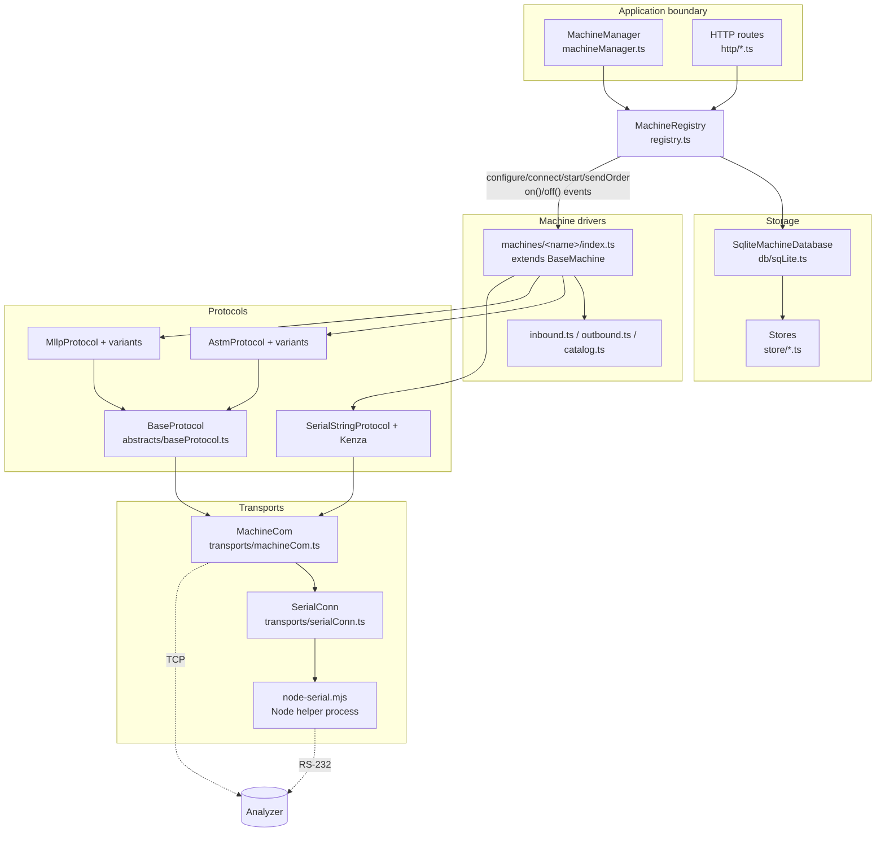
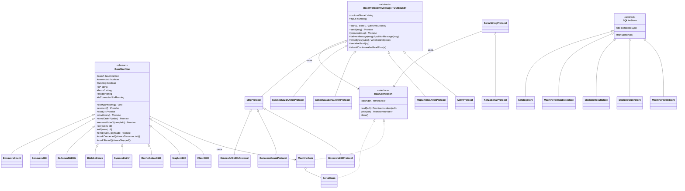

# 3. Architecture and Layers

[← Index](README.md)

## 3.1 Layer diagram

## 3.2 Rules: what belongs where

These rules come from [docs/structure.txt](../structure.txt), and the code follows them.

| Layer | Owns | Must NOT contain |
|---|---|---|
| **Transport** (`transports/`) | Opening and closing a socket or serial port; raw `read()`/`write()` of bytes (`RawConnection`) | Any protocol bytes, parsing, or business logic |
| **Protocol** (`protocols/<family>/`) | Framing, checksums, ENQ/ACK handshakes, reassembly, retries; producing "messages" (record lists or strings) | Analyzer workflow, test catalogs, order/result mapping, database access |
| **Protocol variant** (`protocols/<family>/variants/`) | Byte/session behavior that differs for one analyzer family | Field meanings |
| **Driver** (`machines/<name>/`) | Config schema, lifecycle, query handling, order staging, result mapping, catalog lookup | SQL, direct database access |
| **Registry** (`registry.ts`) | The only place that combines drivers and the database: profiles, orders, results, statistics | HTTP details |
| **HTTP** (`http/`) | Request validation (Zod) and calling registry methods | Direct store or driver access |
| **Manager** (`machineManager.ts`) | Startup and shutdown order, the optional `Deno.serve` | Business rules |

Why this split? A protocol bug fix then helps every analyzer that uses that protocol. Adding
an analyzer usually needs only a new `machines/<name>/` folder. The registry stays the single
source of truth for order status.

## 3.3 Folder map

| Path | Purpose |
|---|---|
| [abstracts/baseMachine.ts](../../abstracts/baseMachine.ts) | Abstract driver: lifecycle methods and the typed event emitter |
| [abstracts/baseProtocol.ts](../../abstracts/baseProtocol.ts) | Abstract protocol: read loop, byte buffer, serialized writes, state |
| [abstracts/baseStore.ts](../../abstracts/baseStore.ts) | `SQLiteStore` base with a `transaction()` helper |
| [transports/](../../transports) | `MachineCom` (TCP server, TCP client, serial) and `SerialConn` |
| [protocols/astm/](../../protocols/astm) | ASTM link (`link.ts`), records, checksum, constants, and variants (Maglumi, cobas, Sysmex) |
| [protocols/hl7/](../../protocols/hl7) | MLLP link and HL7 parse helpers, plus variants (Bonavera 200, Bonavera Count, DrAccu) |
| [protocols/serial/](../../protocols/serial) | Kenza "Custom String" link, BCC, fixed-width records, Kenza variant |
| [machines/](../../machines) | One folder per analyzer, plus [mod.ts](../../machines/mod.ts), which registers all drivers |
| [registry.ts](../../registry.ts) | `MachineRegistry` and the `machineRegistry` singleton |
| [machineManager.ts](../../machineManager.ts) | `MachineManager` (public entry point) |
| [db/sqLite.ts](../../db/sqLite.ts) | Opens SQLite, creates the schema, wires the stores |
| [store/](../../store) | One store class per table, plus catalog seeds |
| [http/](../../http) | Dispatcher and route modules |
| [lib/](../../lib) | Logger, constants (driver ids), utilities, catalog access, the Node serial helper |
| [schema.ts](../../schema.ts) | Zod schemas for HTTP bodies and queries |
| [types.ts](../../types.ts) | All shared TypeScript types |
| [main.ts](../../main.ts) | Stand-alone entry point |
| [tests/](../../tests) | Deno tests |

## 3.4 Class diagram of the abstracts

Note: `SerialStringProtocol` (used by Kenza) does **not** extend `BaseProtocol`. It has its own
read loop and write chain. This is older code. It works differently from the others (for
example, its write chain is not error-safe; see KNOWN_ISSUES M6).

## 3.5 Driver static contract

The registry stores the driver **class**, not an instance. The class must provide the static
members of `RegisteredMachine` ([types.ts](../../types.ts)):

| Static member | Required | Used for |
|---|---|---|
| `id` | yes | Driver id. Must equal the instance's `id` (checked in `createMachine`) |
| `configSchema` | yes | Has `parse(config)`. In practice a Zod object |
| `protocol` | yes | `{name, version}`, shown by `/drivers` and `/health` |
| `brand`, `models` | no | Display |
| `configFields` | no | Tells the UI which form inputs to show |
| `transportType` | no | `'tcp' | 'serial' | 'custom'` for the UI |
| `defaultOrderTests` | no | Tests used when an order has none (Sysmex and Bonavera Count use `CBC`) |

There must also be a constructor with no arguments.

## 3.6 Events

`BaseMachine.emit()` runs all handlers at the same time and **awaits** them. A handler error
therefore travels back to the driver. Drivers use this on purpose: they remove a staged order
only after the registry's `result` handler succeeded (see `docs/fixes.txt` #8).

| Event | Payload | Emitted when | Registry reaction |
|---|---|---|---|
| `connected` | `{source}` | A real peer connection exists (`MachineCom.whenConnected()`) | Log |
| `disconnected` | `{source}` | The protocol closed | Removes the profile from `running` and unbinds handlers |
| `order-query` | `{sampleId?, raw}` | The analyzer asked for orders | Fails expired pending orders |
| `order-sent` | `{order, raw}` | Order bytes were written | Order → `testing`, sets `sentAt`/`startedAt`/estimate |
| `result` | `MachineResultEvent` | A result message was parsed | `persistResult()` (see [page 7](07-registry-and-lifecycle.md)) |
| `error` | `Error` | Anything went wrong | Log |
