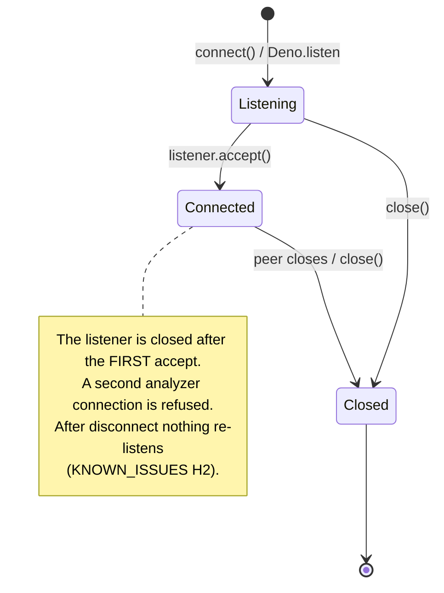
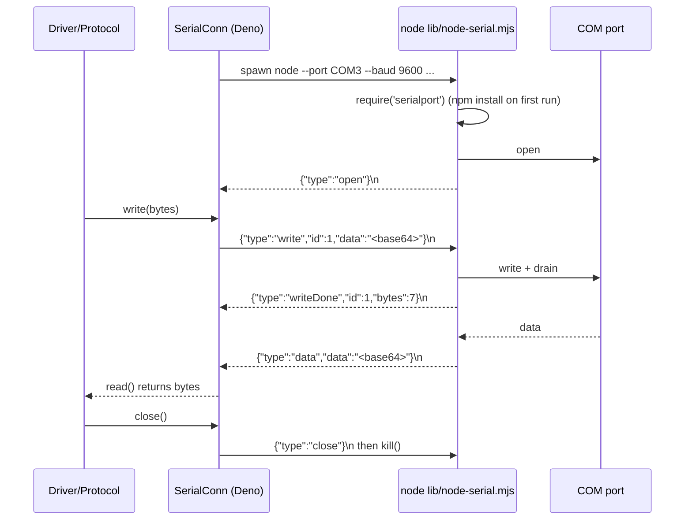

# 4. Transports

[← Index](README.md)

A transport moves raw bytes. Every transport implements `RawConnection`
([types.ts](../../types.ts)): `read(buf)`, `write(buf)`, `close()`, `localAddr`, and
`remoteAddr`. Protocols only ever see this interface.

## 4.1 MachineCom

[transports/machineCom.ts](../../transports/machineCom.ts) is the single transport class that
drivers create. It is built from a `TransportSpec`:

```ts
{ kind: 'tcp-server', host, port }      // analyzer connects to us
{ kind: 'tcp-client', host, port }      // we connect to the analyzer (or to a serial-to-TCP bridge)
{ kind: 'serial', portName, baud, dataBits, stopBits, parity, flowControl?, reconnectDelayMs }
```

Key methods:

| Method | What it does |
|---|---|
| `connect()` | Opens the transport. TCP server: starts `Deno.listen` and returns at once (the accept runs in the background). TCP client: `Deno.connect`. Serial: spawns the helper and waits for `open`. Calls while already connecting share the same promise. |
| `whenConnected()` | Resolves when a real peer exists. Drivers call this to emit `connected` only when the analyzer has actually connected (fix #3 in `docs/fixes.txt`). |
| `read()` / `write()` | Wait for the pending connection if needed, then delegate. |
| `close()` | Closes the listener, the socket, and any pending serial helper. It is idempotent. |

### TCP server lifecycle



Walkthrough:

1. The driver's `connect()` creates `new MachineCom({kind:'tcp-server', host, port})` and awaits
   `com.connect()`.
2. `open()` calls `Deno.listen()` and starts `acceptTcpConnection()` without waiting. The pending
   promise is stored in `pendingConnection`.
3. The protocol read loop calls `com.read()`. That waits on `pendingConnection` until the
   analyzer connects.
4. `acceptTcpConnection()` stores the socket in `conn` and closes the listener.
5. When the analyzer disconnects, `read()` returns `null`. The protocol closes, the driver emits
   `disconnected`, and the registry removes the profile from `running`. To listen again, call
   `POST /profiles/:id/start`.

No TCP keepalive is set, so a silent network failure is not detected.

## 4.2 Serial: SerialConn plus the Node helper

Deno has no stable built-in serial API, so the SDK starts a small Node.js program and talks to it
over stdin and stdout.



### Helper protocol (one JSON object per line)

| Direction | Message |
|---|---|
| Deno → helper | `{type:'write', id, data(base64)}`, `{type:'close'}` |
| helper → Deno | `open`, `data`, `writeDone {id, bytes}`, `writeError {id, message}`, `log {level, message}`, `error {message}`, `close` |

### SerialConn details ([transports/serialConn.ts](../../transports/serialConn.ts))

- Received chunks are queued in `chunks`. `read()` waits until a chunk arrives, the port
  closes, or an error happens.
- `write()` resolves only when the helper reports `writeDone` (that is, after `drain`). It
  rejects on `writeError`, or when the helper exits or closes.
- `fail()` is called when the helper exits, sends `error`, or reports `close`. It rejects
  every pending write and wakes the reader.
- `localAddr`/`remoteAddr` are fake TCP addresses (`hostname` = port name, `port` = baud). They
  exist only so that log messages can show a name.
- With `SERIAL_TRACE=1` (or `COBAS_C111_TRACE`, `SYSMEX_KX21N_TRACE`), every TX and RX chunk is
  logged in hex and as readable text (`[STX]`, `[ETX]`, and so on), using `formatBytes` and
  `visibleBytes` from [lib/utils.ts](../../lib/utils.ts).

### Helper details ([lib/node-serial.mjs](../../lib/node-serial.mjs))

- Arguments: `--port --baud --data-bits --stop-bits --parity none|odd|even --flow none|xonxoff|rtscts`.
- The helper loads `serialport` from
  `${MEDICLOUD_SERIAL_NODE_DIR || LOCALAPPDATA || tmp}/medicloud-machines-serialport`. If that
  fails, it runs `npm install serialport@12.0.0` there first. **The first start needs internet
  access, Node.js, and npm.**
- The port name is upper-cased (this breaks Linux; see KNOWN_ISSUES M12).
- The helper does not exit when stdin closes (KNOWN_ISSUES M13).
- `reconnectDelayMs` is passed in the spec but is **not used** anywhere. There is no automatic
  reopen.

## 4.3 TCP client

Only Kenza in `tcp-bridge` mode uses it, to connect to a serial-to-Ethernet converter.
`Deno.connect()` runs once. If the bridge drops the connection, the profile stops, the same as
for a TCP server.

## 4.4 Choosing a transport in a driver

```ts
const com = new MachineCom(this.transportSpec(config));
this.com = com;
await com.connect();
this.watchConnection(com);     // emits connected via whenConnected()
this.protocol = new SomeProtocol(com, { onMessage, onError, onClose });
```

Every driver follows this pattern. See [page 12](12-how-to.md) for a full template.
