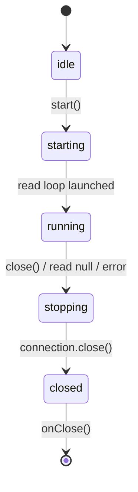
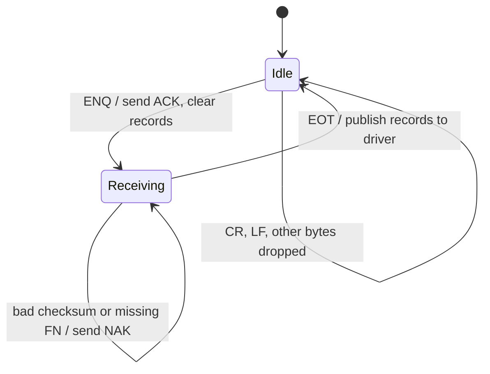
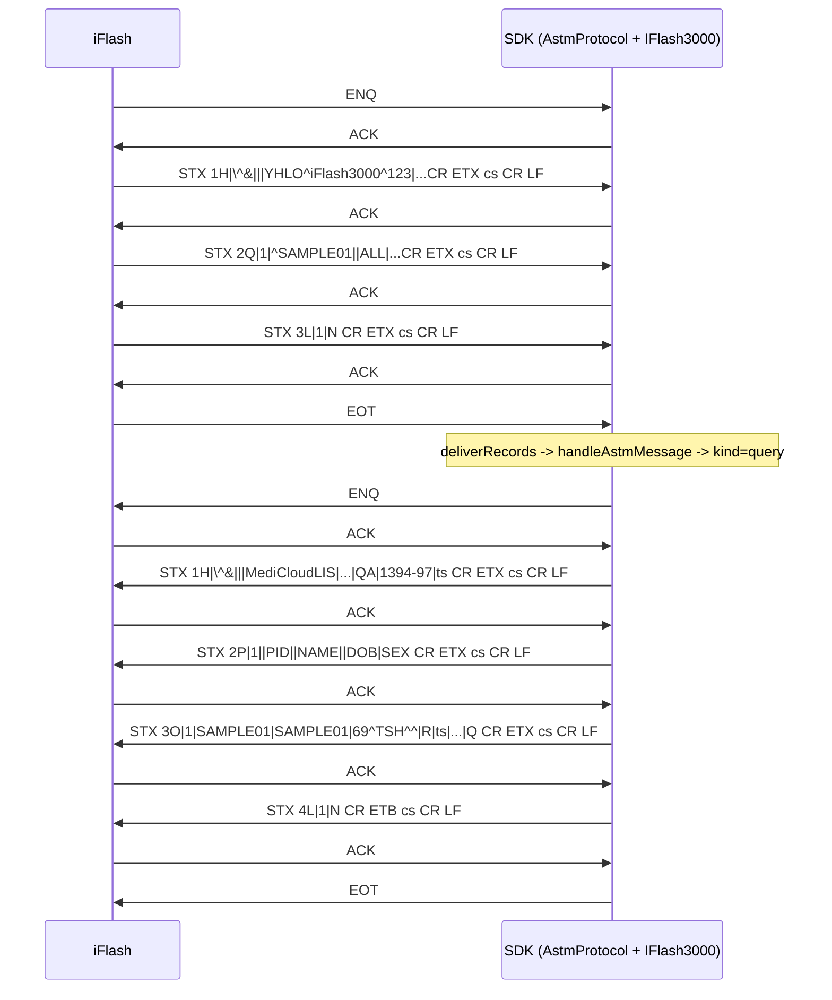
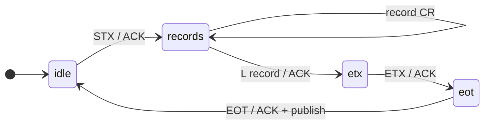
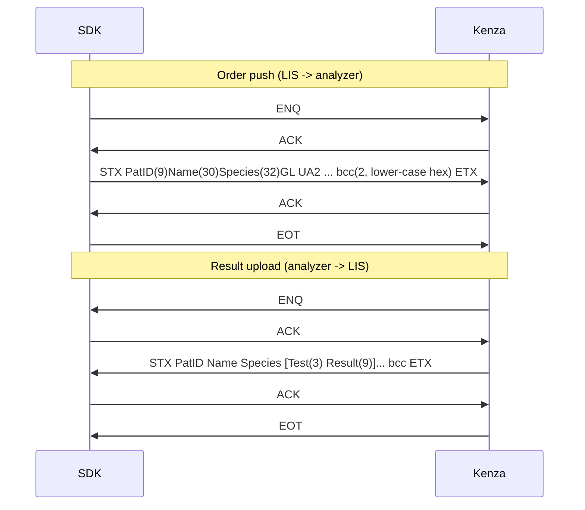

# 5. Protocols

[← Index](README.md)

A protocol turns a byte stream into **messages** and turns outbound messages into bytes. There
are three protocol families and seven concrete classes:

| Class | File | Used by | Message type in / out |
|---|---|---|---|
| `AstmProtocol` | [protocols/astm/link.ts](../../protocols/astm/link.ts) | iFlash 3000 | `AstmRecord[]` / `string[]` |
| `Maglumi800AstmProtocol` | [protocols/astm/variants/maglumi800.ts](../../protocols/astm/variants/maglumi800.ts) | MAGLUMI 800 | `AstmRecord[]` / `string[]` |
| `CobasC111SerialAstmProtocol` | [protocols/astm/variants/cobasC111Serial.ts](../../protocols/astm/variants/cobasC111Serial.ts) | cobas c111 | `AstmRecord[]` / `string[]` |
| `SysmexKx21nAstmProtocol` | [protocols/astm/variants/sysmexKx21n.ts](../../protocols/astm/variants/sysmexKx21n.ts) | Sysmex KX-21N | `SysmexKx21nFrame` (one per frame) / none |
| `MllpProtocol` (+3 subclasses) | [protocols/hl7/link.ts](../../protocols/hl7/link.ts), [variants/](../../protocols/hl7/variants) | DrAccu, Bonavera 200, Bonavera Count | `string` / `string` |
| `SerialStringProtocol` / `KenzaSerialProtocol` | [protocols/serial/link.ts](../../protocols/serial/link.ts), [variants/kenza.ts](../../protocols/serial/variants/kenza.ts) | Kenza | `string` payload / `string` payload |

## 5.1 BaseProtocol (common machinery)

[abstracts/baseProtocol.ts](../../abstracts/baseProtocol.ts) gives every ASTM and MLLP class:

- **State**: `idle → starting → running → stopping → closed`. A closed protocol cannot be
  restarted. A new instance must be created.
- **Read loop** (`readLoop`): reads up to 4096 bytes. `handleReadBytes()` appends them to
  `this.input` (a `number[]`) and calls the subclass's `processInput()`. On `read()` returning
  `null`, an error, or a thrown `processInput`, the loop calls `close()` and then `onClose`.
- **Buffer helpers**: `peekByte`, `shiftByte`, `takeInput`, `bufferedByteLength`. Partial frames
  simply stay in `input` until more bytes arrive. Two messages in one read are handled by the
  `while` loop inside each `processInput`.
- **Writes**: `writeBytes()` chains every write, so an ACK and a frame can never interleave.
  `serializeSend()` makes whole `send()` calls run one at a time.
- **Delivery**: `deliverMessage()` awaits `onMessage` and turns a thrown error into `onError`.
  `publishMessage()` does the same in the background. ASTM uses this so that the read loop keeps
  running while the driver replies, because the reply needs the read loop to receive ACKs.

## 5.2 AstmProtocol (generic E1381/E1394)

Options (`AstmProtocolOptions`):

| Option | Default | Meaning |
|---|---|---|
| `receiveFrameNumber` | `required` | NAK a frame without a `0`-`7` digit after `STX` |
| `receiveChecksum` | `required` | Expect 2 hex characters after `ETX`/`ETB`; NAK on mismatch |
| `sendFrameNumber`, `sendChecksum` | `true` | Outbound framing |
| `intermediateTerminator` / `finalTerminator` | `etx` / `etb` | **Unusual**: standard E1381 is ETB for intermediate and ETX for final. This is kept because the iFlash manual examples do it this way |
| `sendRecordsInSingleFrame` | `false` | Put all records in one frame |
| `reassembleEtbFrames` | `false` | Join ETB continuation frames before splitting records |

### Receive state machine

`processInput()` walks the buffer one byte at a time:

1. If a send is waiting (`ackWaiter`) and the byte is `ACK` or `NAK`, the byte goes to the
   waiter.
2. `ENQ`: reset the receive state and write `ACK`.
3. `EOT`: `deliverRecords()`, which parses each line with `parseAstmRecord()` and calls
   `publishMessage()`.
4. `STX`: `tryReadFrame()`. This finds the terminator, checks the checksum over
   `FN..terminator`, strips one trailing CR/LF, appends the record lines, and writes `ACK`. If the
   frame is incomplete, it returns `false` and waits for more bytes.

Frame numbers are **not** checked against the expected sequence (KNOWN_ISSUES M2).

### Send

`send(lines)` → `serializeSend` → `acquireLink()` (`ENQ`, wait up to 15 s for `ACK`; retry up to
6 times on `NAK` with a 1 s pause) → one frame per record, each waiting for `ACK` (up to 6 tries)
→ `EOT`. A timeout throws at once. Frame numbers start at 1 and wrap 7 → 0.

### Example: iFlash host query, byte by byte

### Records helpers ([records.ts](../../protocols/astm/records.ts))

`parseAstmRecord`, `parseAstmMessage`, `astmField(record, n)` (1-based),
`astmComponent(record, field, comp)`, `repeats`, `buildAstmRecord`, `joinAstmComponents`,
`joinAstmRepeats`, `escapeAstmText` / `unescapeAstmText` (`&E& &F& &R& &S&`). The delimiters are
fixed. The ones declared in the H record are ignored.

## 5.3 Maglumi800AstmProtocol

Two framings, selected by profile config `framing`:

**`numbered`** (the default, matches field firmware):

- Receive: wait until the whole frame is present: `STX FN text ETX|ETB cs1 cs2 CR LF`. A lone
  `STX`, or a frame split anywhere, is handled. Verify the checksum and the `CR LF` (otherwise
  `NAK`). If the frame is **byte-identical to the last one**, ACK it again and do not store it
  (retransmission). Otherwise, if `FN != expected`, `NAK`. Text is decoded with `stream:true` so
  that UTF-8 survives ETB splits.
- On `EOT`: deliver only if the records start with `H` and end with `L`. Otherwise report
  "incomplete … discarded".
- Any unexpected byte other than CR/LF → `NAK`.
- Send: `ENQ`, wait for ACK; each record is split into 240-byte chunks
  (`ETB` intermediate, `ETX` last chunk) with checksum and `CR LF`, each ACKed; then `EOT` (it
  does not wait for an ACK to `EOT`).
- The reply waiter is installed **before** writing, so an instant ACK is never missed.
- Message size is limited to 1 MiB.

**`staged`** (manual section 16.6): every stage is ACKed separately: `ENQ`→ACK, `STX`→ACK,
the record body (one CR-terminated record at a time; ACK after `L`), `ETX`→ACK, `EOT`→ACK.
Sending does the same in reverse.

Debug option: `traceProtocol: true` logs every RX/TX byte in hex (this includes patient data).

## 5.4 CobasC111SerialAstmProtocol

- Receive: `XON`/`XOFF` are ignored. Stray `ACK`/`NAK` are ignored. `ENQ` → `ACK`. A frame is
  read from `STX` up to the first `CR LF`. The parser requires the frame number, finds the last
  `ETX`/`ETB`, verifies the checksum, and **always reassembles** ETB text until `ETX`. `EOT` →
  deliver.
- Send: `ENQ`, **wait 120 ms (no ACK check)**, then each 240-character chunk as
  `STX FN text ETB|ETX cs CR LF`, followed by another 120 ms pause, then `EOT`. NAKs are ignored
  (KNOWN_ISSUES M3).
- Read errors that look like serial idle timeouts (`TimedOut`) are retried after 100 ms instead
  of closing the link.
- `trace: true` logs readable frame text.

## 5.5 SysmexKx21nAstmProtocol

The KX-21N uses ASTM control bytes, but the content is a fixed-width text, not E1394.

- `ENQ` → `ACK` only in Class B. `EOT`, `ACK`, `NAK`, `CR`, `LF`, and `NUL` are skipped.
- Bytes before `STX` are dropped (logged in trace mode).
- A frame is `STX payload ETX|ETB [2 hex chars] [CR] [LF]`. The checksum text is **consumed but
  never checked** (this matches the legacy behavior).
- Class B: `ACK` each frame. Then `deliverMessage({payload, rawFrame, terminator})` once **per
  frame**. The driver joins ETB chunks itself.
- There is no send.

## 5.6 MllpProtocol and HL7 variants

[protocols/hl7/link.ts](../../protocols/hl7/link.ts):

- Receive: find `VT (0x0B)`, discard anything before it, wait for `FS (0x1C)`, take the payload,
  skip one `CR` after `FS` if present, and decode it as UTF-8. Several messages in one read are
  all delivered. If there is no `VT` in the buffer, `processUnframedInput()` is called. If the
  buffer grows past 64 KB with no complete message, it is cleared.
- Send: wrap the message in `VT … FS CR`. It does not wait for an application ACK.
- Static helpers: `parseHl7Message(raw)` (segments split on `CR`, fields on `|`, plus MSH-9/10/12/7),
  `getField(segment, n)` (handles the MSH numbering offset), `getComponent`, `getRepetitions`,
  `findSegment`, `findSegments`. HL7 escape sequences are not decoded.

Variants differ only in `processUnframedInput()`:

| Variant | Unframed bytes |
|---|---|
| `Bonavera200Protocol` | Discarded |
| `BonaveraCountProtocol` | Discarded |
| `DrAccuAfi6100bProtocol` | Split on CR/LF. Lines starting with `R|` are delivered as messages. A non-`R|` line stops processing (KNOWN_ISSUES H6) |

## 5.7 SerialStringProtocol (Kenza "Custom String")

[protocols/serial/link.ts](../../protocols/serial/link.ts) is peer-to-peer and half-duplex:

- BCC = (sum of the payload bytes) mod 256 as **lower-case** 2-character hex. It is placed
  **before** `ETX` ([checksum.ts](../../protocols/serial/checksum.ts)).
- The text is encoded as 8-bit Latin-1, not UTF-8.
- If an `ENQ` arrives while we wait for an ACK, we answer `NAK` ("busy").
- `send()` first waits up to 15 s while an inbound transaction is active. ENQ and frame retries:
  3 attempts each. ACK timeout: 15 s.
- Payloads are delivered on `EOT`, without waiting for the handler.
- [records.ts](../../protocols/serial/records.ts): `encodeKenzaOrder` and `decodeKenzaResult`
  (Id8/Id9 widths, fixed-width fields). Values are truncated and padded (KNOWN_ISSUES H3).
