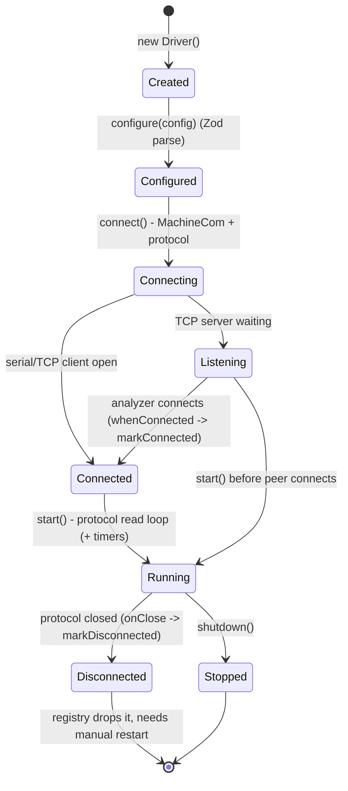

# 6. Machines (Drivers)

[← Index](README.md)

Every driver lives in `machines/<name>/` and is registered in
[machines/mod.ts](../../machines/mod.ts). The usual files are:

| File | Content |
|---|---|
| `index.ts` | The driver class: static metadata, Zod `configSchema`, `configFields`, lifecycle, workflow |
| `inbound.ts` | Turns analyzer messages into a query or a `MachineResultEvent` |
| `outbound.ts` | Builds order, no-order, and ACK messages |
| `catalog.ts` | Seed test list plus lookups. Lookups read the **database** catalog through `managedCatalogTests(driverId)` ([lib/catalogAccess.ts](../../lib/catalogAccess.ts)) |
| `astm.ts` | Protocol option selection (iFlash, cobas, Sysmex) |
| `resultMetadata.ts` | Analyte names and units (Sysmex, Bonavera Count) |

All drivers share the same lifecycle:

`configure()` throws if the driver is already active. Most drivers clear their staged orders in
`shutdown()`. The registry stages them again on the next start (`synchronizeOrders`).

---

## 6.1 YHLO iFlash 3000 (`iflash3000`)

- **Code**: [machines/iflash/](../../machines/iflash). **Protocol**: `AstmProtocol` with
  [IFLASH_ASTM_OPTIONS](../../machines/iflash/astm.ts) (FN and checksum required, ETX
  intermediate / ETB final, no ETB reassembly). **Transport**: TCP server.
- **Config** (`configSchema`): `host` (string, required), `port` (1-65535), `queryReplyDelayMs`
  (int ≥ 0, optional; the UI default is 0). The UI defaults are `0.0.0.0:7001`.
- **Workflow (host query)**:
  1. `sendOrder()` checks that every test exists in the DB catalog (`requireIFlashTestEntry`; the
     test's first analyte code must be a numeric **channel**), then stages the order by `sampleId`.
  2. The analyzer sends `Q`. `parseIFlashMessage` reads the sample from Q field 3 (component 2,
     otherwise component 1).
  3. The driver emits `order-query`, waits `queryReplyDelayMs`, and sends either
     `buildIFlashOrderResponse` (H, P, O with `channel^name^^` repeats and report type `Q`, L) or
     `buildIFlashNoOrderResponse` (`L|1|I`).
  4. It updates the staged copy to `testing` and emits `order-sent`.
  5. On `R` records: sample = O field 4, otherwise O field 3 component 1; patient = P field 4. Each
     R record: field 3 = `assayNo^name^^resultType`, field 4 = `value^qualitative`, unit 5,
     range 7, flag 8, status 10, completedAt 14 (check these positions; see KNOWN_ISSUES M10). It
     emits `result`, then removes the staged order.
- **Catalog**: about 100 assays with channel numbers ([catalog.ts](../../machines/iflash/catalog.ts)).
  The analyte code is the channel number, so stored `assayNo` values are channel numbers.
- **Quirks**: the H sender field is scanned for the "iflash" model. The variant (`1800`/`3000`)
  comes from the model string. A message with several O records is not split (KNOWN_ISSUES H4).

## 6.2 SNIBE MAGLUMI 800 (`snibe-maglumi-800`)

- **Code**: [machines/maglumi800/](../../machines/maglumi800). **Protocol**:
  `Maglumi800AstmProtocol`. **Transport**: TCP server.
- **Config**: `host`, `port`, `queryReplyDelayMs?`, `traceProtocol?` (boolean),
  `framing?` (`numbered` (default) | `staged`).
- **Workflow**:
  1. Orders are staged by `sampleId` (test codes must be non-empty; they are not checked against
     the catalog).
  2. `Q` record: `querySampleId` = the first Q field 3 component that is not empty and not `ALL`
     (with `$lc$` removed). `queryAll` is true if field 3 or 5 contains `$LC$` or `ALL`.
  3. **Query all** (empty sample + queryAll): send up to **20** staged orders that are not
     `testing` and not expired. **Single**: the matching order, if it is not expired.
  4. Response: H (sender and receiver swapped from the request), then for each order
     `P|1||pid|pid|name||yyyymmdd|M/F/U` and `O|1|sample||^^^DEVICECODE\…|R|ts|||||A`, then
     `L|1|N`. If nothing is found: H + `L|1|N`.
  5. It emits `order-sent` for each order.
  6. Results: sample = O field 3, otherwise field 4 (then the patient ID, then `UNKNOWN_<ms>`). For
     each R record: the assay name is the last non-numeric component of field 3, mapped through
     the catalog (code, name, deviceCode, aliases). Value 4, unit 5 (otherwise the catalog unit),
     range 6 (otherwise the catalog range; `a - b` or `a to b`), flag 7, status 9, completedAt 13.
  7. Duplicate suppression: the key is `sampleId + raw`, removed again if storing fails.
- **Catalog**: 47 assays with units, ranges, categories, and aliases
  ([catalog.ts](../../machines/maglumi800/catalog.ts)). `deviceCode` is the name sent on the wire.

## 6.3 Roche cobas c111 (`roche-cobas-c111`)

- **Code**: [machines/rocheCobasC111/](../../machines/rocheCobasC111). **Protocol**:
  `CobasC111SerialAstmProtocol` (240-character frames, 120 ms gap). **Transport**: serial.
- **Config** (every field is required unless marked): `serialPort` (mapped to `portName`), `baud`,
  `dataBits` 5-9, `stopBits` 1/1.5/2, `parity` n/o/e, `flowControl` none/xonxoff/rtscts (UI
  default `xonxoff`), `reconnectDelayMs` (unused), `replyToQueries`, `pushOrders`,
  `pushIntervalMs`, `resultPollingEnabled`, `resultPollInitialDelayMs`, `resultPollIntervalMs`,
  `hostSenderName`, `analyzerName`, `defaultComment?`, `trace`.
- **Three workflows** (each can be switched on separately):
  1. **Query reply** (`replyToQueries`): a message with H field 11 starting with `TSREQ` and a Q
     record. The sample is the last component of Q field 3. The reply is `TSDWN^REPLY`: H, `P|1`,
     `O|1|sample||^^^767\^^^454|R||||||A||…|O\Q`, `C|1|L|comment^^^^|G`, `L|1|N`. If there is no
     order: an O record with report type `Z`.
  2. **Push** (`pushOrders`): every `pushIntervalMs`, each staged order that is not `testing` and
     not expired is sent as `TSDWN^BATCH` (H, O, L), then marked sent.
  3. **Result polling** (`resultPollingEnabled`): after `resultPollInitialDelayMs`, every
     `resultPollIntervalMs`, the driver sends `RSREQ^REAL` with `Q|1|^sample||ALL||||||||F` for each
     `testing` order.
- **Results**: R records that have a value. The sample comes from O field 4 component 1, otherwise
  field 3 (see KNOWN_ISSUES M9). The assay is the last component of field 3, mapped to the host
  code through the catalog. Value/qualitative come from field 4; unit 5; range 6 or 7;
  flag 7 or 8; status 9 or 10; completedAt 13 or 14.
- **Catalog**: 21 Roche host codes with short names (for example, `767` GLU2)
  ([catalog.ts](../../machines/rocheCobasC111/catalog.ts)). `toCobasC111HostCode()` maps a code,
  name, or alias to the host code.
- **Also available**: `buildCobasC111InventoryQuery` (INR^U06). It is built but not used.

## 6.4 Sysmex KX-21 / KX-21N (`sysmex-kx21n`)

- **Code**: [machines/sysmexKx21n/](../../machines/sysmexKx21n). **Protocol**:
  `SysmexKx21nAstmProtocol`. **Transport**: serial. **Default tests**: `['CBC']`.
- **Config**: the serial fields (same as cobas, with UI default flow `none`), plus `protocol`
  (`class-a` | `class-b`), `outputFormat` (`auto` | `kx-21n` | `k-1000`), `dateOrder` (`ymd` |
  `mdy` | `dmy`), `stripSampleLeadingZeroes`, `estimatedMinutes` (unused), and `trace`.
- **Workflow (upload only)**: `sendOrder()` only checks that every test is in the catalog
  (normally `CBC`) and stages the order so that the result can be matched. No bytes are sent.
- **Parsing** ([inbound.ts](../../machines/sysmexKx21n/inbound.ts)), in this order:
  1. **ASTM-style**: if the payload looks like `H|`/`P|`/`R|` records, the sample is O field 3
     (or 4), and each R record becomes an analyte (code = last component of field 3).
  2. **Fixed width**: the payload starts with `D`. The layout is chosen by length (≥129 →
     KX-21N, otherwise K-1000) or by `outputFormat`. Header: text code, block, sample code (`S`/`U`
     = patient, `C` = QC, which is ignored), date, 1 info character, sample ID (15 or 12), 6 PDA
     characters, then 5-character data fields. Each field is 4 digits with implied decimals plus 1
     flag character. `*003…` means overflow (`OVR`, flag `>`); any other `*` means `ERR`. The
     flags `0/1/2/3/4` map to `N/H/L/>/?`.
  3. **Plain text** lines such as `WBC: 6.5 10^3/uL H` (a fallback).
  - KX-21N has 19 fields (WBC … P-LCR, including RDW-SD and RDW-CV). K-1000 has 18 fields (RDW
    instead).
  - Units come from the catalog analytes. No reference ranges are produced (on purpose).
- **Quirks**: leading zeros are stripped by default (KNOWN_ISSUES L12). ETB chunks are joined
  in the driver. ASTM-style records in separate ETX frames are not joined (KNOWN_ISSUES H5).

## 6.5 BioLabo Kenza 240TX (`biolabo-kenza`)

- **Code**: [machines/biolaboKenza/](../../machines/biolaboKenza). **Protocol**:
  `KenzaSerialProtocol`. **Transport**: serial, or TCP client in `tcp-bridge` mode.
- **Config**: `transport` (`serial` | `tcp-bridge`), the serial fields (UI defaults COM4,
  19200 8N1, no flow control), `host` and `port` (bridge, default `127.0.0.1:9100`), `idLength`
  (8 | 9), `pushIntervalMs` (≥ 100), `estimatedMinutes`, and `trace`. All of them are required,
  even the ones the chosen transport does not use.
- **Workflow (push)**:
  1. `sendOrder()` stages the order (no catalog check).
  2. A `setInterval` timer runs every `pushIntervalMs`. For each staged `pending` order, it builds
     the payload with `buildKenzaOrder` (ID = `sampleId`, type field = species, then sample type,
     then sex mapped to `Man`/`Women`/`Children`, tests mapped through `toKenzaTestCode`),
     sends it, marks it `testing`, and emits `order-sent`. A `pushing` flag prevents overlapping
     runs.
  3. Results: `decodeKenzaResult` reads the fixed fields. Each `Test(3)+Result(9)` group becomes an
     analyte. The code is mapped through the catalog (slot, code, name, or alias). The value is
     tidied (`"012.340"` → `"12.34"`). The sample = the patient ID field.
- **Catalog**: 20 slots ([catalog.ts](../../machines/biolaboKenza/catalog.ts)), for example
  slot 6 `GL` Sugar. Catalog tests must have a `slot`.
- **Quirks**: IDs are truncated to 8 or 9 characters (KNOWN_ISSUES H3). Expired orders are still
  pushed (M8). The analyzer must be in Id8 or Id9 mode to match `idLength`.

## 6.6 DrAccu AFI-6100B (`draccu-afi-6100b`)

- **Code**: [machines/draccuAfi6100b/](../../machines/draccuAfi6100b). **Protocol**:
  `DrAccuAfi6100bProtocol` (MLLP plus unframed `R|` lines). **Transport**: TCP server.
- **Config**: `host`, `port` (UI default 9011), `pushOrders` (default false),
  `pushIntervalMs` (default 1000), `estimatedMinutes` (default 15).
- **Workflow**:
  1. Orders are staged. Renaming a sample (same `order.id`) removes the old key.
  2. If `pushOrders` is on and the analyzer is connected, a `setTimeout` loop sends
     `ORM^O01` (MSH, PID, `ORC|NW|sample|sample`, one OBR per test with `test^test` or
     `id^name`), and marks each order sent.
  3. Results: only messages starting with `R|`. Fields: [1] sample, [2] item ID (assayNo),
     [3] item name, [5] high, [6] low, [8] value, [9] unit, [10] result text (used as the flag,
     the qualitative value, and the status), [11] timestamp. **One analyte per line**
     (KNOWN_ISSUES H1).
- **Catalog**: the item IDs and names seen on the client's screens
  ([catalog.ts](../../machines/draccuAfi6100b/catalog.ts)). The order flow sends test names
  as they are (for example, `FRT`). The catalog is only used for lookups.

## 6.7 Bonavera 200 (`bonavera-200`)

- **Code**: [machines/bonavera200/](../../machines/bonavera200). **Protocol**:
  `Bonavera200Protocol` (MLLP). **Transport**: TCP server.
- **Config**: `host`, `port` (UI default 9007), `estimatedMinutes` (default 15).
- **Workflow (HL7 query)**:
  1. `sendOrder()` requires that every test code exists in the catalog (numeric codes, for example
     `1` = Glu).
  2. The analyzer sends `QRY^Q02`. The sample comes from QRD-8 component 1. If it is empty, the
     driver uses all `pending` orders.
  3. The SDK sends `QCK^Q02` with `QAK|SR|OK` or `NF`, then one `DSR^Q03` per order. The DSR echoes
     QRD and QRF, has 28 `DSP` lines (1 patient ID, 3 name, 4 DOB, 5 sex, **21 barcode = sampleId,
     22 numeric sample number**, 23 time, 24 `N`, 25 `1`, 26 sample type), then `DSP|29+` with
     `testNo^^^`, and `DSC` with a continuation pointer.
  4. `ORU^R01`: sample = OBR-2, otherwise OBR-3. Patient = PID-3, otherwise PID-2, otherwise the
     name. Each OBX: 3 id, 4 name, 5 value, 6 unit, 7 range, 8 flag, 11 status, 14 time. The
     driver emits `result`, then answers `ACK` (`MSA|AA`).
  5. Every ORU also appends its analyte ids, names, and units (no patient data) to
     `./data/bonavera200-catalog-captures.jsonl`, to help build the real catalog.
- **Quirks**: KNOWN_ISSUES M11 (the numeric sample number).

## 6.8 Biogeny Bonavera Count (`bonavera-count`)

- **Code**: [machines/bonaveraCount/](../../machines/bonaveraCount). **Protocol**:
  `BonaveraCountProtocol` (MLLP). **Transport**: TCP server. **Default tests**: `['CBC']`.
- **Config**: `host`, `port` (UI default 9008), `pushOrders` (default **true**),
  `pushIntervalMs` (1000), `estimatedMinutes` (3).
- **Workflow**:
  1. Push: `ORM^O01` (MSH, PID, and OBR with `CBC^Complete Blood Count`) for each pending,
     unexpired order.
  2. Query (`QBP` or `QRY`): the sample comes from QPD-3 or QRD-8. Reply `RSP^K11` with
     `QAK|…|OK` + PID + OBR, or `NF`.
  3. `ORU`: sample = OBR-2, otherwise OBR-3, otherwise the patient ID, otherwise the patient name.
     Each OBX becomes an analyte (range `a-b`, flag default `N`). **Then a "near match" step: if no
     staged order has this exact ID, but exactly one numeric ID differs by one digit, the result is
     renamed to that ID** (KNOWN_ISSUES C2). The driver stores first, then sends `ACK`. Duplicates
     are skipped by their raw text.
- **Catalog**: `CBC` with the analytes from
  [resultMetadata.ts](../../machines/bonaveraCount/resultMetadata.ts).
