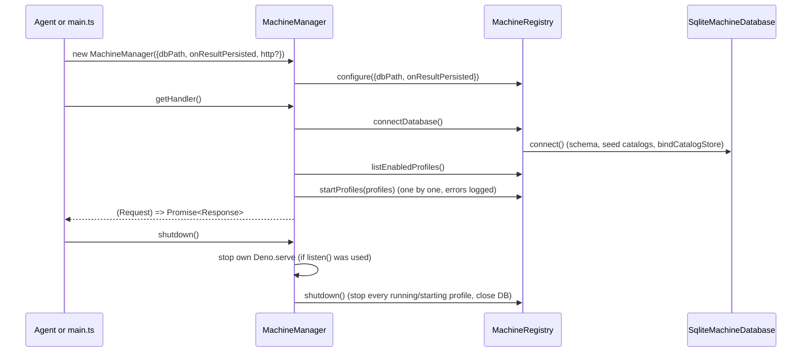
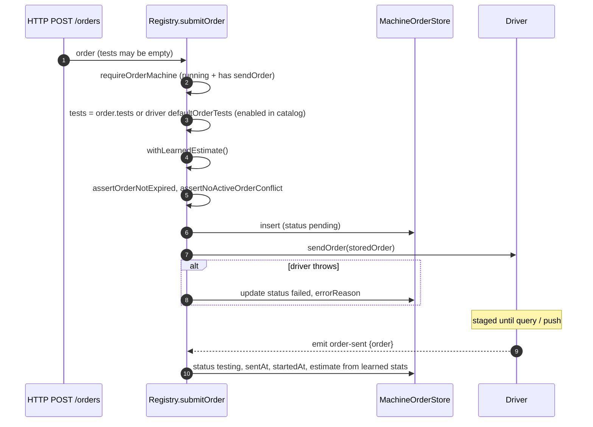
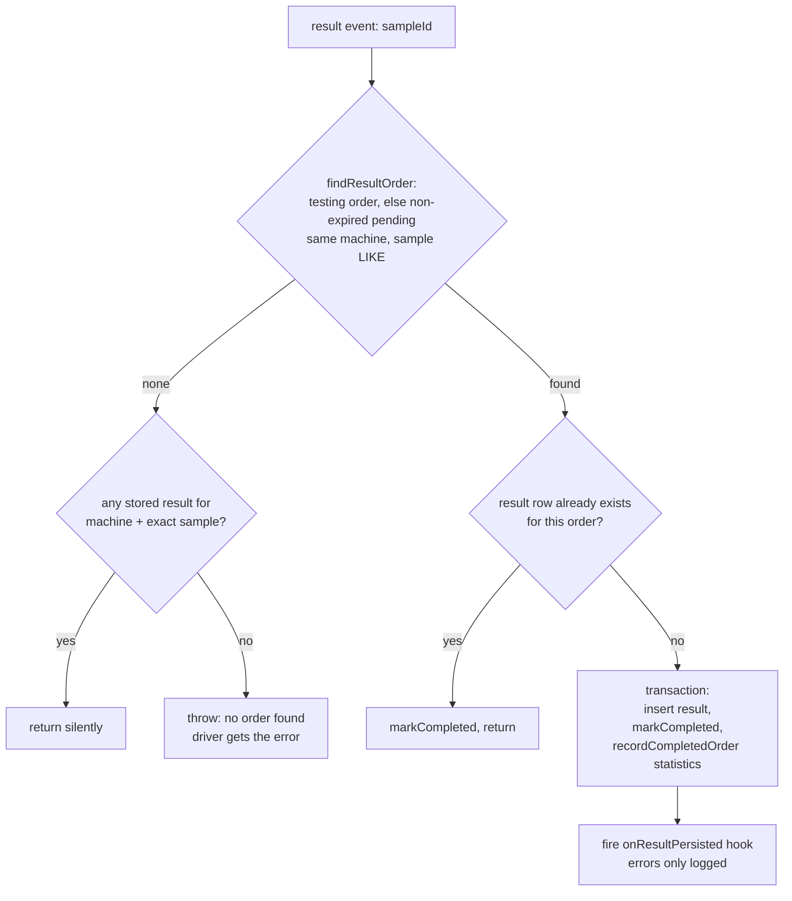

# 7. Registry and Machine Lifecycle

[← Index](README.md)

[registry.ts](../../registry.ts) holds `MachineRegistry` and its singleton `machineRegistry`.
[machines/mod.ts](../../machines/mod.ts) registers the 8 drivers on that singleton when it is
imported. [machineManager.ts](../../machineManager.ts) imports `mod.ts`, so creating a manager is
enough to get all drivers.

Internal maps:

| Map | Key | Holds |
|---|---|---|
| `registrations` | driver id | driver classes |
| `running` | profile id | `{profile, machine}` after a successful start |
| `starting` | profile id | `{machine, promise}` while starting (prevents double starts) |
| `eventBindings` | profile id | the exact handler functions, so that `off()` can remove them |

## 7.1 MachineManager startup and shutdown

`listen(callback?)` does the same as `getHandler()`, but also starts its own `Deno.serve`
when `http.enabled` is true (default host `127.0.0.1`, port `8080`), and rolls back on failure.

## 7.2 Starting one profile

`startProfile(profile)` → `startMachine(profile, machine)`:

1. `createMachine()`: `new Driver()`; the check `machine.id === Driver.id`.
2. `machine.configure(profile.config)`: Zod validation. If it fails, no transport is opened.
3. `bindMachineEvents()`: attaches the six handlers (section 7.4).
4. `await machine.connect()`: opens the transport and builds the protocol.
5. `await synchronizeOrders()`: loads `pending` orders from the DB. Expired ones are marked
   `failed`. The others get a fresh learned estimate and are passed to `sendOrder()`. Then every
   `testing` order is staged again too.
6. `await machine.start()`: the protocol read loop and timers start.
7. If `!machine.isRunning`, it throws (the protocol closed during startup).
8. `running.set(id, {profile, machine})`.
9. On any error: `machine.shutdown()`, unbind events, and rethrow.

`startProfiles()` runs this one profile at a time, so one bad profile cannot stop the others
(fix #4). `startStoredProfile(id)` (HTTP `POST /profiles/:id/start`) first cleans up a stale,
non-running entry, sets `enabled=1`, starts, and sets `enabled=0` again if the start fails.
`stopStoredProfile` stops the profile and sets `enabled=0`.

`updateProfile()` refuses driver or config changes while a profile is running or starting.
Disabling a profile stops it. Enabling a profile starts it.

## 7.3 Order flow

Other order operations:

- `updateOrder(id, patch)`: refuses `completed` orders and moving to another machine. It
  re-checks expiry and conflicts, calls `sendOrder(merged)` on the running driver when the order is
  pending or testing, then updates the DB. (Sample renames are not cleaned up in most drivers;
  see KNOWN_ISSUES M1.)
- `resendOrder(id)`: only `failed` or `pending` orders. It resets the processing fields
  (`prepareForResend`), gives an expired order 24 more hours, and stages it again.
- `deleteOrder(id)`: refused if the order is completed or has a result. It calls
  `removeOrder(sampleId)` on the driver first.
- Expiry: orders default to 24 h (`DEFAULT_ORDER_EXPIRY_MS`). Expired pending orders are marked
  failed at startup sync and when a driver emits `order-query` (`failExpiredPendingOrders`). Push
  drivers that never emit `order-query` are not swept (KNOWN_ISSUES M8).

## 7.4 Event handlers

| Event | Handler logic |
|---|---|
| `connected` | Log only |
| `disconnected` | If this instance is the one in `running`, delete it and unbind. **There is no auto-restart.** |
| `order-query` | `failExpiredPendingOrders(machineId, machine, sampleId)` |
| `order-sent` | Update the order to `testing`. The duration estimate comes **only** from learned statistics; any estimate set by the driver is ignored |
| `result` | `persistResult()` |
| `error` | `log.error` |

## 7.5 Result matching (`persistResult`)

Important consequences (see [KNOWN_ISSUES.md](KNOWN_ISSUES.md)):

- The sample lookup uses `LIKE '%id%'` (C1).
- Only one result row per order is kept (H1).
- Results with no order are not stored (M14).

## 7.6 Learned turnaround statistics

[store/testStatisticStore.ts](../../store/testStatisticStore.ts): when a result completes an order,
the duration is `receivedAt − (startedAt ?? sentAt ?? createdAt)`. For each unique test in the
order, the store upserts a row in `machine_test_statistics`:
`average = (average × count + duration) / (count + 1)`.

`estimateOrderDurationMs(machineId, tests)` returns the **largest** average among the tests, but
only if **every** test has history. Otherwise it returns `undefined`. The registry converts this to
minutes in `withLearnedEstimate()`. It is used at submit, at resend, at startup sync, and at
`order-sent`.

## 7.7 Catalog management

The registry passes catalog calls through to the DB catalog store (`listCatalogs`, `getCatalog`
by driver id or machine name, `createCatalog`, `renameCatalog`, `upsertCatalogTest`,
`deleteCatalogTest`). `STATIC_CATALOGS` in [http/utils.ts](../../http/utils.ts) is empty. It is a
place for future read-only catalogs. `activeDefaultTests(driverId)` keeps only the default tests
that are enabled in the DB catalog.

## 7.8 Registry public methods

`configure`, `register`, `unregister`, `listDrivers`, `listCatalogs`, `getCatalog`,
`createCatalog`, `renameCatalog`, `upsertCatalogTest`, `deleteCatalogTest`, `listRunning`,
`connectDatabase`, `startStoredProfile`, `stopStoredProfile`, `startProfiles`, `startProfile`,
`stopProfile`, `queryProfiles`, `listEnabledProfiles`, `getProfile`, `countProfiles`,
`createProfile`, `updateProfile`, `deleteProfile`, `countOrders`, `queryOrders`, `getOrder`,
`submitOrder`, `updateOrder`, `resendOrder`, `deleteOrder`, `listResults`, `countResults`,
`getResult`, `listTestStatistics`, `countTestStatistics`, `getTestStatistic`,
`deleteTestStatistic`, and `shutdown`.
