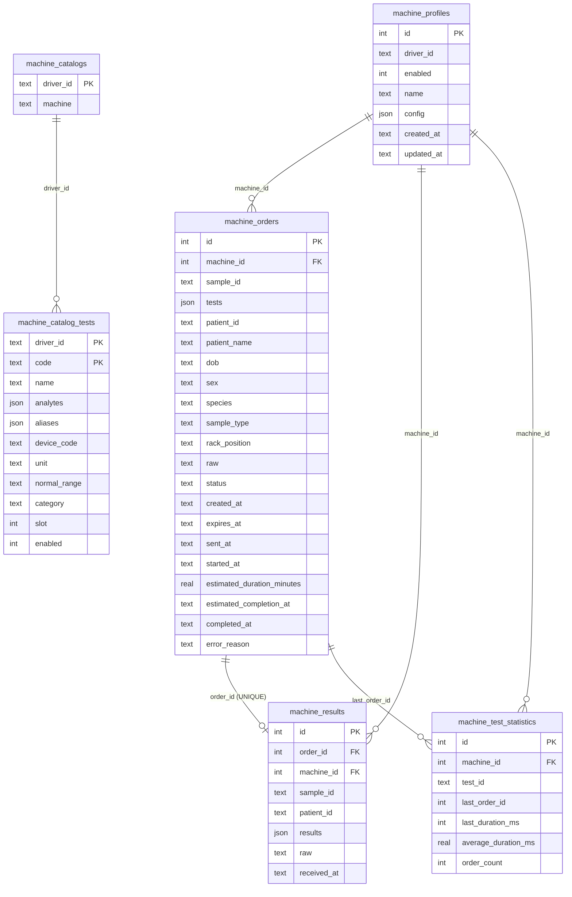

# 8. Storage (SQLite)

[← Index](README.md)

The SDK uses `node:sqlite` (`DatabaseSync`), so every call is synchronous.
[db/sqLite.ts](../../db/sqLite.ts) does the following:

1. Creates the parent folder (`ensureDbDirectory`).
2. Opens the file and turns on `PRAGMA journal_mode = WAL` and `foreign_keys = ON`.
3. Creates the tables and indexes with `IF NOT EXISTS`. There are **no migrations**, so a column
   change needs a manual migration.
4. Seeds the default catalogs once (`CatalogStore.seedDefaults()` from
   [store/catalogSeeds.ts](../../store/catalogSeeds.ts)).
5. Binds the catalog store globally (`bindCatalogStore`), so that driver catalog lookups work.
   **Drivers fail if the database is not connected.**

## 8.1 Tables



Important constraints and indexes:

- `idx_machine_orders_active_sample`: **UNIQUE** `(machine_id, sample_id)` where the status is
  `pending` or `testing`. Only one active order per sample per machine is allowed.
- `idx_machine_results_order`: **UNIQUE** `order_id`. Only one result row per order (see
  KNOWN_ISSUES H1).
- Foreign keys use `ON DELETE RESTRICT`, so history cannot be deleted from under results. The
  registry also refuses to delete a profile that has orders, results, or statistics.
- All dates are ISO-8601 strings in UTC.

## 8.2 Stores

| Store | File | Notes |
|---|---|---|
| `MachineProfileStore` | [store/profileStore.ts](../../store/profileStore.ts) | `query` filters by id, driverId, name (LIKE), enabled, limit, offset |
| `MachineOrderStore` | [store/orderStore.ts](../../store/orderStore.ts) | `query` uses **`sample_id LIKE %x%`** and `status LIKE` (KNOWN_ISSUES C1). `findPending`/`listPending` use exact matches. `prepareForResend` and `markCompleted` (keeps the first `completed_at`) |
| `MachineResultStore` | [store/resultStore.ts](../../store/resultStore.ts) | Exact matching. `normalizeMachineResultPayload` validates the analyte shape (and accepts snake_case aliases) on write **and** read |
| `MachineTestStatisticStore` | [store/testStatisticStore.ts](../../store/testStatisticStore.ts) | Running averages; `test_id` is case-insensitive |
| `CatalogStore` | [store/catalogStore.ts](../../store/catalogStore.ts) | Per-driver catalog with an in-memory cache. A test that is used by an active order cannot be edited or deleted (`CatalogInUseError`, HTTP 409) |

The cross-store transaction (`SqliteMachineDatabase.transaction`) uses `BEGIN IMMEDIATE`. It must
stay synchronous, so never put an `await` inside it.

## 8.3 Catalog model

```text
CatalogView { id, driverId, machine, tests[], source:'database' }
  CatalogTestEntry { code, name, analytes[], aliases?, deviceCode?, unit?, normalRange?,
                     category?, slot?, enabled? }
    CatalogAnalyteEntry { code (must equal result assayNo), name, unit?, category?, decimals? }
```

- **Test** = what you order. **Analyte** = what comes back.
- Seeds are inserted only when that driver's catalog does not exist yet. Later edits through the
  HTTP API persist across restarts. To get the new seeds after a code change, you must delete the
  catalog row (or the database).
- Drivers use the catalog to send codes to the analyzer and to name the codes they receive:
  iFlash channel numbers, Maglumi device names, Roche host codes, Kenza slots and codes, and the
  Sysmex and Bonavera Count analyte units.
